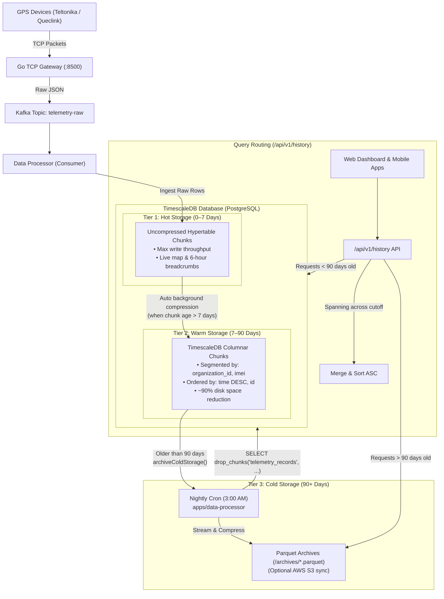

# GPS Telemetry Data Lifecycle & Archival Architecture

This document describes the 3-tier storage architecture, automatic compression, and long-term archival policy implemented in **Fleet Vision**.

---

## 1. Architecture Overview

Fleet Vision processes millions of GPS telemetry records daily. To balance **maximum real-time write performance**, **instant query speeds**, and **cloud storage cost-efficiency**, telemetry data moves through three automated tiers:

| Tier | Data Age | Storage Engine | Format & State | Purpose & Performance |
| :--- | :--- | :--- | :--- | :--- |
| **Tier 1: Hot** | **0–7 days** | TimescaleDB | **Uncompressed Chunks** | High write throughput, fast indexing, live vehicle tracking, 6h journey breadcrumbs, current day playback. |
| **Tier 2: Warm** | **7–90 days** | TimescaleDB | **Columnar Compressed** | Native TimescaleDB compression (~90% storage reduction). Transparently queryable via standard SQL. |
| **Tier 3: Cold** | **90+ days** | Apache Parquet / S3 | **Snappy-Compressed Parquet** | Nightly cron exports to Parquet, then drops expired TimescaleDB chunks in $O(1)$ time to reclaim 100% disk space. |

---

## 2. End-to-End Lifecycle & Data Flow



---

## 3. Tier 1: Hot Storage (0–7 Days)

### Behavior
- All incoming GPS points from devices are written directly into the `telemetry_records` hypertable.
- During the first 7 days, TimescaleDB stores rows in standard PostgreSQL table blocks without compression.

### Why Uncompressed?
1. **Zero Compression Overhead**: Ingestion workers can write thousands of points per second without consuming CPU on column compression.
2. **Fast Indexing & Row Updates**: Indexes on `time`, `[imei, time]`, and `[organization_id, time]` remain immediately mutable and fast.
3. **Optimized for Live Queries**: Powers the live dashboard, recent geofence checks, and the **6-hour real-time journey breadcrumb** path with sub-millisecond latencies.

---

## 4. Tier 2: Warm Storage (7–90 Days)

### Behavior
- TimescaleDB's internal background worker daemon (`policy_compression`) regularly evaluates all hypertable chunks.
- When an entire chunk's data reaches **7 days of age**, TimescaleDB automatically transforms that chunk from row-oriented storage into **native columnar format**.

### Configuration
```sql
-- 1. Enable columnar compression
ALTER TABLE "telemetry_records" SET (
  timescaledb.compress,
  timescaledb.compress_segmentby = 'organization_id, imei',
  timescaledb.compress_orderby = 'time DESC, id'
);

-- 2. Configure automated 7-day compression policy
SELECT add_compression_policy('telemetry_records', INTERVAL '7 days', if_not_exists => TRUE);
```

### Key Technical Considerations
- **Segmenting (`compress_segmentby`)**: By segmenting on `organization_id, imei`, all telemetry points for a specific vehicle within a tenant are compressed together in contiguous columnar arrays. Similar values (coordinates, speeds, statuses) compress by **up to 90%** (10 GB shrinks to ~1 GB).
- **Ordering & Composite Primary Keys (`compress_orderby`)**: In Prisma, `telemetry_records` uses a composite primary key `@@id([id, time])`. TimescaleDB strictly requires that **all primary key columns must be included in either `compress_segmentby` or `compress_orderby`**. Placing `id` in `compress_orderby = 'time DESC, id'` satisfies database integrity constraints while keeping segmentation grouped by vehicle.
- **Transparent Querying**: Compressed chunks remain **100% queryable via normal SQL and Prisma**. TimescaleDB decompresses rows on-the-fly in memory. The dashboard and reporting APIs require **zero code changes** to read warm data.

---

## 5. Tier 3: Cold Storage (90+ Days)

### Behavior
- Every day at **3:00 AM**, the `data-processor` cold-storage worker runs:
  ```typescript
  cron.schedule("0 3 * * *", () => {
    archiveColdStorage();
  });
  ```
- Any records older than `RETENTION_DAYS` (default: **90 days**) are exported to Parquet and dropped from TimescaleDB.

### Step-by-Step Archival Sequence:
1. **Query & Batch**: Scans `telemetry_records` where `time < (NOW() - 90 days)`.
2. **Parquet Export**: Streams batches of 10,000 records into a compressed Apache Parquet file stored under `archives/telemetry_archive_<timestamp>.parquet`.
3. **S3 Upload (Production)**: When configured, the Parquet archive is pushed to long-term cloud object storage (AWS S3 Glacier or Standard).
4. **Instant Chunk Drop (`drop_chunks`)**:
   Instead of running slow `DELETE FROM` statements (which can fail or stall on compressed hypertable chunks), the worker calls:
   ```sql
   SELECT drop_chunks('telemetry_records', older_than => $1::timestamptz);
   ```
   This drops the underlying chunk files at the filesystem level in $O(1)$ time, immediately reclaiming disk space without fragmentation.

### History API Dual-Tier Reading
The history endpoint (`/api/v1/history`) seamlessly supports long-term playback across both tiers:
- **Date range within 90 days**: Queries TimescaleDB directly (seamlessly scanning hot uncompressed + warm compressed chunks).
- **Date range older than 90 days**: Reads directly from Parquet files using `@dsnp/parquetjs`.
- **Date range spanning both**: Queries both sources, merges the records, and returns a single chronological route.

---

## 6. Environment Variables Reference

| Variable | Default | Location | Description |
| :--- | :--- | :--- | :--- |
| `RETENTION_DAYS` | `90` | `.env`, `apps/data-processor/.env` | Number of days data remains in TimescaleDB before Parquet archival and chunk purging. |
| `ENABLE_COLD_STORAGE` | `true` | `.env`, `apps/data-processor/.env` | Master toggle to enable/disable the 3:00 AM Parquet archival worker. |
| `PURGE_AFTER_ARCHIVE` | `true` | `.env`, `apps/data-processor/.env` | When `true`, drops archived chunks from TimescaleDB after Parquet export. |
| `ARCHIVE_DIR` | `../../archives` | `.env` | Local filesystem directory path for storing generated `.parquet` files. |

---

## 7. Operations & Verification Runbook

### Applying Policies to Database

#### Via NPM Script (Recommended)
From `fleet-vision/`:
```bash
npm run db:apply:policies
```

#### Via Docker CLI Directly
- **Local Development (`fv-postgres`):**
  ```bash
  docker exec -i fv-postgres psql -U postgres -d fleet_vision < scripts/apply-timescaledb-policies.sql
  ```
- **Production (`fv-timescaledb`):**
  ```bash
  docker exec -i fv-timescaledb psql -U postgres -d fleet_vision < scripts/apply-timescaledb-policies.sql
  ```

---

### Verification Queries

#### 1. Check Compression Policy Configuration
```bash
docker exec -i fv-postgres psql -U postgres -d fleet_vision -c "
SELECT hypertable_name, attname, segmentby_column_index, orderby_column_index, orderby_asc 
FROM timescaledb_information.compression_settings 
WHERE hypertable_name = 'telemetry_records';
"
```

#### 2. Check the Background Compression Job
```bash
docker exec -i fv-postgres psql -U postgres -d fleet_vision -c "
SELECT job_id, application_name, schedule_interval, next_start, config 
FROM timescaledb_information.jobs 
WHERE proc_name = 'policy_compression';
"
```

#### 3. View Chunks and Compression State
```bash
docker exec -i fv-postgres psql -U postgres -d fleet_vision -c "
SELECT chunk_name, range_start, range_end, is_compressed 
FROM timescaledb_information.chunks 
WHERE hypertable_name = 'telemetry_records'
ORDER BY range_start DESC;
"
```

#### 4. Manually Compress a Chunk (Testing)
```sql
SELECT compress_chunk('_timescaledb_internal._hyper_1_1_chunk');
```

#### 5. Manually Decompress a Chunk (Testing)
```sql
SELECT decompress_chunk('_timescaledb_internal._hyper_1_1_chunk');
```

---

## 8. Summary of Benefits

1. **Write Throughput**: Raw inserts never compete with real-time compression locks.
2. **Storage Efficiency**: Warm data achieves ~90% compression, drastically delaying database disk scaling.
3. **Infinite Retention**: Parquet files can be retained in S3 Glacier for years at a fraction of relational database costs.
4. **Operational Simplicity**: No manual partitioning, no manual vacuuming, and no manual table rotation required.

