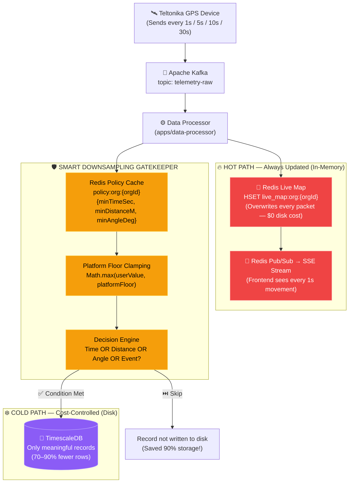
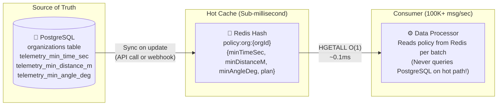

# Fleet Vision — Smart Downsampling & Dynamic Telemetry Policy Architecture

> **Document Type**: Enterprise Architecture Decision Record (ADR)  
> **Status**: Production-Ready Design  
> **Applies To**: `apps/data-processor` (Kafka Consumer → TimescaleDB Writer)  
> **Last Updated**: October 2026

---

## Table of Contents

1. [Problem Statement](#1-problem-statement)
2. [Architecture Overview](#2-architecture-overview)
3. [The Golden Triangle Formula](#3-the-golden-triangle-formula)
4. [Platform Floor Clamping (Cost Protection)](#4-platform-floor-clamping-cost-protection)
5. [Dynamic Per-Tenant Policy System](#5-dynamic-per-tenant-policy-system)
6. [Data Flow: Hot Path vs Cold Path](#6-data-flow-hot-path-vs-cold-path)
7. [Cost Impact Analysis](#7-cost-impact-analysis)
8. [Implementation Guide](#8-implementation-guide)
   - [8.1 Database Schema Changes](#81-database-schema-changes)
   - [8.2 Redis Policy Cache Layer](#82-redis-policy-cache-layer)
   - [8.3 Math Utilities (Distance & Angle)](#83-math-utilities-distance--angle)
   - [8.4 The Clamping & Decision Engine](#84-the-clamping--decision-engine)
   - [8.5 Integration into Data Processor](#85-integration-into-data-processor)
9. [Subscription Tier Monetization](#9-subscription-tier-monetization)
10. [TimescaleDB Compression & Retention](#10-timescaledb-compression--retention)
11. [Monitoring & Observability](#11-monitoring--observability)
12. [FAQ](#12-faq)

---

## 1. Problem Statement

Fleet Vision accepts GPS telemetry from Teltonika tracking devices via TCP. The device transmission interval is configured by the customer in the **Teltonika Configurator** software. Fleet Vision has **no control** over what interval customers choose.

### The Risk

| Customer Configuration | Records / Day / Vehicle | DB Rows / Day (100 Vehicles) | Monthly Storage (Uncompressed) |
|---|---|---|---|
| 30s interval (conservative) | 2,880 | 288,000 | ~1.5 GB |
| 10s interval (standard) | 8,640 | 864,000 | ~4.5 GB |
| 5s interval (aggressive) | 17,280 | 1,728,000 | ~9 GB |
| **1s interval (extreme)** | **86,400** | **8,640,000** | **~45 GB** |

A single customer setting their 100 vehicles to 1-second intervals would generate **8.64 million rows/day** and consume **~45 GB/month** of database storage, overwhelming the system and ballooning cloud costs.

### The Requirement

1. **Live Map must always feel real-time** — even if the device sends every 1 second, the operator's dashboard must show the vehicle moving smoothly every second.
2. **Database writes must be cost-controlled** — regardless of device configuration, the database must only store "meaningful" data points.
3. **Per-tenant customization** — enterprise customers should be able to request higher-frequency storage (and pay for it).
4. **Zero data loss guarantee** — no telemetry packet should be silently dropped. The live map always gets every ping; only the database write frequency is governed.

---

## 2. Architecture Overview



### Key Principle: Dual-Path Processing

Every incoming telemetry packet is processed through **two independent paths**:

| Path | Target | Update Frequency | Disk Cost | Purpose |
|---|---|---|---|---|
| **🔥 Hot Path** | Redis (RAM) | **Every packet** (1s, 5s, whatever the device sends) | **$0** (in-memory overwrite) | Live map markers, SSE streams, real-time dashboard |
| **❄️ Cold Path** | TimescaleDB (Disk) | **Only when the Smart Filter approves** (15s / 100m / 30° minimum) | **Controlled** | Historical routes, trip reports, analytics, compliance |

> **Critical Insight**: The user's screen experience is governed by the Hot Path (Redis). The Cold Path (Database) is invisible to the end user. Therefore, reducing Cold Path writes has **zero impact on user experience** while dramatically cutting server costs.

---

## 3. The Golden Triangle Formula

The Smart Downsampling Filter uses three geometric conditions known in the telematics industry as the **"Golden Triangle"**:

```
SAVE TO DATABASE = (ΔTime ≥ T) OR (ΔDistance ≥ D) OR (ΔAngle ≥ A) OR (Event Trigger)
```

Each condition serves a distinct purpose:

### 3.1 Time Trigger (`ΔTime ≥ 15 seconds`)

**Purpose**: Guarantees periodic data points even when the vehicle is barely moving.

**Scenario**: Vehicle crawling in heavy traffic at 3 km/h.
- At 3 km/h, the vehicle moves only **0.83 meters per second**.
- It would take **120 seconds** to travel 100 meters (the distance trigger would never fire).
- The 15-second time trigger ensures at least **4 data points per minute** during traffic jams.

### 3.2 Distance Trigger (`ΔDistance ≥ 100 meters`)

**Purpose**: Increases data density at high speeds automatically.

**Scenario**: Vehicle on a highway at 120 km/h (33.3 m/s).
- The vehicle covers 100 meters in just **3 seconds**.
- The distance trigger fires **every 3 seconds** at highway speed, capturing enough points to accurately reconstruct the route.
- Without this trigger, a 15-second timer would only produce 1 point every 500 meters at highway speed, creating inaccurate route lines that cut through buildings and fields.

### 3.3 Angle Trigger (`ΔAngle ≥ 30 degrees`)

**Purpose**: Preserves the shape of turns, roundabouts, and intersections.

**Scenario**: Vehicle turning right at an intersection.
- The turn happens over 2 seconds and covers only 15 meters.
- Neither the time trigger (< 15s) nor the distance trigger (< 100m) would fire.
- The angle trigger detects the 90° heading change and immediately captures the turning point.
- **This is the key to beautiful historical routes** — without angle-based sampling, all curves appear as straight diagonal lines cutting through buildings on the map.

### 3.4 Event Override Triggers (Always Save Immediately)

Certain business-critical events **bypass all filters** and are saved to the database unconditionally:

| Event | Why It Must Always Be Saved |
|---|---|
| **Ignition ON / OFF** | Marks trip start and trip end — essential for trip reports, utilization calculations, and fleet billing |
| **Geofence Entry / Exit** | Compliance evidence — "when exactly did the truck enter the warehouse zone?" |
| **Speed Alert Triggered** | Safety audit trail — legally required in some jurisdictions |
| **Harsh Braking / Acceleration** | Driver behavior scoring, insurance claims |
| **Fuel Level Sudden Drop** | Fuel theft detection |
| **External Power Disconnected** | Tamper / theft alert |

---

## 4. Platform Floor Clamping (Cost Protection)

### 4.1 The Problem with Unrestricted User Configuration

In a multi-tenant SaaS platform, you **cannot trust customer configurations**:
- A customer might set 1-second intervals "just to try it out" and forget to change it back.
- A developer testing integrations might set 0.5-second intervals.
- A malicious actor could deliberately flood your system.

### 4.2 The Solution: Platform Hard Floors

Define **immutable minimum thresholds** that no standard-tier customer can go below:

```typescript
const PLATFORM_FLOOR = {
  MIN_TIME_SEC: 15,      // No standard user can write to DB faster than every 15 seconds
  MIN_DISTANCE_M: 100,   // No standard user can write to DB for less than 100m movement
  MIN_ANGLE_DEG: 30,     // No standard user can write to DB for less than 30° turn
};
```

### 4.3 Clamping Formula

For every tenant policy, the system computes the **Effective Policy**:

```
Effective = Math.max(UserRequested, PlatformFloor)
```

### 4.4 Resolution Examples

| Customer | Requested Policy | Platform Floor | `Math.max()` Applied | **Effective Policy** |
|---|---|---|---|---|
| **Org A** | `30s / 200m / 35°` | `15s / 100m / 30°` | `max(30,15) / max(200,100) / max(35,30)` | **30s / 200m / 35°** ✅ Accepted as-is |
| **Org B** | `25s / 150m / 30°` | `15s / 100m / 30°` | `max(25,15) / max(150,100) / max(30,30)` | **25s / 150m / 30°** ✅ Accepted as-is |
| **Org C** | `5s / 10m / 10°` | `15s / 100m / 30°` | `max(5,15) / max(10,100) / max(10,30)` | **15s / 100m / 30°** 🛡️ Clamped to floor |
| **Org D** | `10s / 50m / 15°` | `15s / 100m / 30°` | `max(10,15) / max(50,100) / max(15,30)` | **15s / 100m / 30°** 🛡️ Clamped to floor |
| **Org E (Paid)** | `5s / 20m / 10°` | `5s / 20m / 10°` (paid floor) | `max(5,5) / max(20,20) / max(10,10)` | **5s / 20m / 10°** 💎 Premium unlocked |

> **Key**: Customer C and D's **live maps still update every 1 second or 5 seconds** (Hot Path is unaffected). Only their database write frequency is governed.

---

## 5. Dynamic Per-Tenant Policy System

### 5.1 Where Policies Are Stored



### 5.2 Why Redis Cache Is Mandatory

The Data Processor handles **thousands of Kafka messages per second**. If it queried PostgreSQL for the organization's policy on every message:
- PostgreSQL would receive **100,000+ queries/second** just for policy lookups.
- Latency would spike from 0.1ms (Redis) to 5–20ms (PostgreSQL), creating a 200x slowdown.

**Solution**: Cache the policy in a Redis Hash (`policy:org:{orgId}`). Read it once per batch. Invalidate only when the admin updates the policy via the API.

---

## 6. Data Flow: Hot Path vs Cold Path

### 6.1 Real-World Example: 30 Seconds of City Driving

A vehicle drives through a city with a **1-second tracker** (worst-case scenario):

| Second | Vehicle Action | Redis (Hot) | TimescaleDB (Cold) | Trigger Reason |
|---|---|---|---|---|
| `T+00` | Ignition ON | 🟢 Updated | 💾 **Saved** | **Ignition Event** |
| `T+01` | Accelerates to 20 km/h | 🟢 Updated | ⏭️ Skipped | Straight, < 15s, < 100m |
| `T+02` | 20 km/h straight | 🟢 Updated | ⏭️ Skipped | — |
| `T+03` | 25 km/h straight | 🟢 Updated | ⏭️ Skipped | — |
| `T+04` | 30 km/h straight | 🟢 Updated | ⏭️ Skipped | — |
| `T+05` | 35 km/h straight | 🟢 Updated | ⏭️ Skipped | — |
| `T+06` | **Turns right 90°** | 🟢 Updated | 💾 **Saved** | **Angle ≥ 30°** |
| `T+07` | 30 km/h on new road | 🟢 Updated | ⏭️ Skipped | — |
| `T+08` | 35 km/h straight | 🟢 Updated | ⏭️ Skipped | — |
| `T+09` | 40 km/h straight | 🟢 Updated | ⏭️ Skipped | — |
| `T+10` | 40 km/h straight | 🟢 Updated | ⏭️ Skipped | — |
| `T+11` | 45 km/h straight | 🟢 Updated | ⏭️ Skipped | — |
| `T+12` | 45 km/h straight | 🟢 Updated | ⏭️ Skipped | — |
| `T+13` | 50 km/h straight | 🟢 Updated | ⏭️ Skipped | — |
| `T+14` | 50 km/h straight | 🟢 Updated | ⏭️ Skipped | — |
| `T+15` | 50 km/h straight | 🟢 Updated | ⏭️ Skipped | — |
| `T+16` | 50 km/h straight | 🟢 Updated | ⏭️ Skipped | — |
| `T+17` | 50 km/h straight | 🟢 Updated | ⏭️ Skipped | — |
| `T+18` | 50 km/h straight | 🟢 Updated | ⏭️ Skipped | — |
| `T+19` | 55 km/h straight | 🟢 Updated | ⏭️ Skipped | — |
| `T+20` | 55 km/h straight | 🟢 Updated | ⏭️ Skipped | — |
| `T+21` | 55 km/h, 15s since T+06 | 🟢 Updated | 💾 **Saved** | **Time ≥ 15s** |
| `T+22` | 55 km/h straight | 🟢 Updated | ⏭️ Skipped | — |
| `T+23` | 60 km/h straight | 🟢 Updated | ⏭️ Skipped | — |
| `T+24` | Brakes hard! | 🟢 Updated | 💾 **Saved** | **Alert Event** |
| `T+25` | 20 km/h | 🟢 Updated | ⏭️ Skipped | — |
| `T+26` | Stops, Ignition OFF | 🟢 Updated | 💾 **Saved** | **Ignition Event** |

**Result**: 27 incoming packets → **5 database writes** → **81% reduction in storage cost!**

**User Experience**: The operator saw the car move **27 times on screen** (perfectly smooth).

---

## 7. Cost Impact Analysis

### 7.1 Storage Savings at Scale

| Fleet Size | Without Filter (10s interval) | With Filter (15s / 100m / 30°) | Savings |
|---|---|---|---|
| 100 vehicles | 864,000 rows/day (~4.5 GB/mo) | ~170,000 rows/day (~0.9 GB/mo) | **80%** |
| 500 vehicles | 4,320,000 rows/day (~22.5 GB/mo) | ~860,000 rows/day (~4.5 GB/mo) | **80%** |
| 1,000 vehicles | 8,640,000 rows/day (~45 GB/mo) | ~1,700,000 rows/day (~9 GB/mo) | **80%** |
| 5,000 vehicles | 43,200,000 rows/day (~225 GB/mo) | ~8,600,000 rows/day (~45 GB/mo) | **80%** |

### 7.2 Combined Savings (Filter + TimescaleDB Compression)

When combined with TimescaleDB's native compression (10–20x reduction), the total savings are enormous:

| Stage | 1,000 Vehicles @ 10s Interval |
|---|---|
| **Raw (No Optimization)** | ~45 GB/month |
| **After Smart Downsampling** | ~9 GB/month (80% reduction) |
| **After TimescaleDB Compression** | ~0.9 GB/month (additional 90% reduction) |
| **Total Reduction** | **98% savings** (45 GB → 0.9 GB) |

### 7.3 Infrastructure Cost Savings (Monthly)

| Component | Without Filter | With Filter + Compression | Monthly Savings |
|---|---|---|---|
| TimescaleDB Storage (gp3 EBS) | ~$36 (450 GB) | ~$1 (9 GB) | **$35** |
| PostgreSQL Write IOPS | High CPU load (degraded queries) | 80% fewer writes | Faster queries |
| Backup Storage (S3) | ~$10 | ~$0.20 | **$9.80** |
| EC2 Instance (can use smaller) | `t4g.xlarge` needed | `t4g.large` sufficient | **~$24** |
| **Total Monthly Savings** | | | **~$69/month per 1K vehicles** |

---

## 8. Implementation Guide

### 8.1 Database Schema Changes

Add policy fields to the `Organization` model in `packages/db/prisma/schema.prisma`:

```prisma
model Organization {
  id                  String    @id @default(cuid())
  name                String
  // ... existing fields ...

  /// ── Dynamic Telemetry Policy ─────────────────────────────
  /// Configurable per organization. Values below Platform Floor
  /// are automatically clamped by the Data Processor.
  telemetryMinTimeSec   Int @default(15) @map("telemetry_min_time_sec")
  telemetryMinDistanceM Int @default(100) @map("telemetry_min_distance_m")
  telemetryMinAngleDeg  Int @default(30) @map("telemetry_min_angle_deg")

  // ... existing fields ...
}
```

Run the migration:
```bash
npm run db:generate
npm run db:push
```

### 8.2 Redis Policy Cache Layer

Add to `packages/db/src/redis.ts`:

```typescript
// ─── Telemetry Policy Cache ──────────────────────────────────

export interface OrgTelemetryPolicy {
  minTimeSec: number;
  minDistanceM: number;
  minAngleDeg: number;
  subscriptionPlan: string;
}

/**
 * Caches an organization's telemetry downsampling policy in Redis.
 * Called when:
 *   1. An organization is created (uses defaults)
 *   2. An admin updates the policy via the API
 *   3. A subscription tier changes (unlocking higher frequency)
 */
export async function cacheOrgTelemetryPolicy(
  orgId: string,
  policy: OrgTelemetryPolicy
): Promise<void> {
  await redis.hset(`policy:org:${orgId}`, {
    minTimeSec: String(policy.minTimeSec),
    minDistanceM: String(policy.minDistanceM),
    minAngleDeg: String(policy.minAngleDeg),
    subscriptionPlan: policy.subscriptionPlan,
  });
}

/**
 * Retrieves the cached telemetry policy for an organization.
 * Returns null if no policy is cached (Data Processor falls back to defaults).
 */
export async function getCachedOrgTelemetryPolicy(
  orgId: string
): Promise<OrgTelemetryPolicy | null> {
  const data = await redis.hgetall(`policy:org:${orgId}`);
  if (!data || Object.keys(data).length === 0) return null;
  return {
    minTimeSec: parseInt(data.minTimeSec, 10) || 15,
    minDistanceM: parseInt(data.minDistanceM, 10) || 100,
    minAngleDeg: parseInt(data.minAngleDeg, 10) || 30,
    subscriptionPlan: data.subscriptionPlan || "STANDARD",
  };
}

/**
 * Invalidates the cached policy (forces re-read from PostgreSQL on next access).
 */
export async function invalidateOrgTelemetryPolicy(
  orgId: string
): Promise<void> {
  await redis.del(`policy:org:${orgId}`);
}
```

### 8.3 Math Utilities (Distance & Angle)

Create a new file `apps/data-processor/src/downsampling.ts`:

```typescript
/**
 * Smart Downsampling Engine for Fleet Vision
 *
 * Implements the "Golden Triangle" (Time / Distance / Angle) filter
 * with per-tenant dynamic policies and platform floor clamping.
 */
import { getCachedOrgTelemetryPolicy, type OrgTelemetryPolicy } from "@fleet-vision/db";

// ─── Platform Hard Floors ────────────────────────────────────
// These are the absolute minimum thresholds for STANDARD tier users.
// No standard customer can write to the database more frequently than this.

const PLATFORM_FLOOR = {
  MIN_TIME_SEC: 15,
  MIN_DISTANCE_M: 100,
  MIN_ANGLE_DEG: 30,
};

// Premium tier floors (for paying customers who need higher frequency)
const PREMIUM_FLOOR = {
  MIN_TIME_SEC: 5,
  MIN_DISTANCE_M: 20,
  MIN_ANGLE_DEG: 10,
};

// ─── Math Utilities ──────────────────────────────────────────

/**
 * Haversine formula: calculates the great-circle distance between
 * two GPS coordinates in meters.
 */
export function getDistanceMeters(
  lat1: number,
  lon1: number,
  lat2: number,
  lon2: number
): number {
  const R = 6371e3; // Earth radius in meters
  const dLat = ((lat2 - lat1) * Math.PI) / 180;
  const dLon = ((lon2 - lon1) * Math.PI) / 180;
  const a =
    Math.sin(dLat / 2) * Math.sin(dLat / 2) +
    Math.cos((lat1 * Math.PI) / 180) *
      Math.cos((lat2 * Math.PI) / 180) *
      Math.sin(dLon / 2) *
      Math.sin(dLon / 2);
  const c = 2 * Math.atan2(Math.sqrt(a), Math.sqrt(1 - a));
  return R * c;
}

/**
 * Computes the minimum angular difference between two headings,
 * correctly handling the 359° → 1° wrap-around.
 *
 * Example: getAngleDelta(350, 10) returns 20 (not 340).
 */
export function getAngleDelta(angle1: number, angle2: number): number {
  const diff = Math.abs(angle1 - angle2) % 360;
  return diff > 180 ? 360 - diff : diff;
}

// ─── Per-Device Last-Saved State Cache ───────────────────────

interface LastSavedState {
  timestamp: number;    // Unix ms of last DB-saved record
  latitude: number;
  longitude: number;
  angle: number;
  ignition: boolean;
}

const lastSavedStateMap = new Map<string, LastSavedState>();

function updateLastSavedState(
  imei: string,
  record: {
    timestamp: string;
    latitude: number;
    longitude: number;
    angle: number;
    ignition: boolean;
  }
): void {
  lastSavedStateMap.set(imei, {
    timestamp: new Date(record.timestamp).getTime(),
    latitude: record.latitude,
    longitude: record.longitude,
    angle: record.angle,
    ignition: record.ignition,
  });
}

// ─── Policy Resolution (Clamping) ────────────────────────────

/**
 * Resolves the effective downsampling policy for an organization
 * by clamping user-requested values against the platform floor.
 *
 * Standard tier: clamped to PLATFORM_FLOOR (15s / 100m / 30°)
 * Premium tier:  clamped to PREMIUM_FLOOR  (5s / 20m / 10°)
 */
export function resolveEffectivePolicy(
  orgPolicy: OrgTelemetryPolicy | null
): { minTimeSec: number; minDistanceM: number; minAngleDeg: number } {
  if (!orgPolicy) {
    return {
      minTimeSec: PLATFORM_FLOOR.MIN_TIME_SEC,
      minDistanceM: PLATFORM_FLOOR.MIN_DISTANCE_M,
      minAngleDeg: PLATFORM_FLOOR.MIN_ANGLE_DEG,
    };
  }

  // Select the appropriate floor based on subscription tier
  const floor =
    orgPolicy.subscriptionPlan === "ENTERPRISE_HIGH_FREQ"
      ? PREMIUM_FLOOR
      : PLATFORM_FLOOR;

  return {
    minTimeSec: Math.max(orgPolicy.minTimeSec, floor.MIN_TIME_SEC),
    minDistanceM: Math.max(orgPolicy.minDistanceM, floor.MIN_DISTANCE_M),
    minAngleDeg: Math.max(orgPolicy.minAngleDeg, floor.MIN_ANGLE_DEG),
  };
}

// ─── The Decision Engine ─────────────────────────────────────

/**
 * Determines whether a telemetry record should be persisted to
 * TimescaleDB (Cold Path) based on the organization's effective
 * downsampling policy.
 *
 * This function is called for EVERY record. The Hot Path (Redis
 * live map + SSE) is always updated regardless of this result.
 *
 * @returns true if the record should be saved to the database
 */
export async function shouldSaveToDatabase(
  orgId: string,
  imei: string,
  record: {
    timestamp: string;
    latitude: number | null;
    longitude: number | null;
    angle: number | null;
    ignition: boolean;
    eventId?: number;
  }
): Promise<boolean> {
  // ── Rule 0: Always save if GPS coordinates are invalid ─────
  if (record.latitude === null || record.longitude === null) {
    return true; // Save it; the DB can decide what to do with null coords
  }

  const lastState = lastSavedStateMap.get(imei);

  // ── Rule 1: Always save the first record for a device ──────
  if (!lastState) {
    updateLastSavedState(imei, {
      timestamp: record.timestamp,
      latitude: record.latitude,
      longitude: record.longitude,
      angle: record.angle || 0,
      ignition: record.ignition,
    });
    return true;
  }

  // ── Rule 2: Always save ignition state changes ─────────────
  if (record.ignition !== lastState.ignition) {
    updateLastSavedState(imei, {
      timestamp: record.timestamp,
      latitude: record.latitude,
      longitude: record.longitude,
      angle: record.angle || 0,
      ignition: record.ignition,
    });
    return true;
  }

  // ── Rule 3: Always save event-triggered records ────────────
  if (record.eventId && record.eventId > 0) {
    updateLastSavedState(imei, {
      timestamp: record.timestamp,
      latitude: record.latitude,
      longitude: record.longitude,
      angle: record.angle || 0,
      ignition: record.ignition,
    });
    return true;
  }

  // ── Rule 4: Fetch org policy and apply clamped thresholds ──
  const cachedPolicy = await getCachedOrgTelemetryPolicy(orgId);
  const policy = resolveEffectivePolicy(cachedPolicy);

  const currentTs = new Date(record.timestamp).getTime();
  const timeDiffSec = (currentTs - lastState.timestamp) / 1000;
  const distMeters = getDistanceMeters(
    lastState.latitude,
    lastState.longitude,
    record.latitude,
    record.longitude
  );
  const angleDiff = getAngleDelta(lastState.angle, record.angle || 0);

  const timeTrigger = timeDiffSec >= policy.minTimeSec;
  const distanceTrigger = distMeters >= policy.minDistanceM;
  const angleTrigger = angleDiff >= policy.minAngleDeg;

  const shouldSave = timeTrigger || distanceTrigger || angleTrigger;

  if (shouldSave) {
    updateLastSavedState(imei, {
      timestamp: record.timestamp,
      latitude: record.latitude,
      longitude: record.longitude,
      angle: record.angle || 0,
      ignition: record.ignition,
    });
    return true;
  }

  // ── Skip: None of the conditions were met ──────────────────
  return false;
}
```

### 8.4 Integration into Data Processor

In `apps/data-processor/src/processor.ts`, modify the record processing loop. Replace the section that pushes directly into `validRecords` with a filter check:

```typescript
import { shouldSaveToDatabase } from "./downsampling";

// Inside processTelemetryBatch(), for each record:
for (const record of records) {
  // ... existing ignition detection and fuel logic ...

  // ── HOT PATH: Always update Redis (live map + SSE) ─────
  // (This code already exists — keep it unchanged)

  // ── COLD PATH: Smart filter for database writes ────────
  const saveToDb = await shouldSaveToDatabase(orgId, imei, {
    timestamp: record.timestamp,
    latitude: record.latitude,
    longitude: record.longitude,
    angle: record.angle,
    ignition,
    eventId: record.event_id,
  });

  if (saveToDb) {
    validRecords.push({ /* ... existing record shape ... */ });
  }
}
```

### 8.5 API Endpoint for Updating Policies

Add an API route in `apps/web-dashboard/src/app/api/v1/organizations/[orgId]/telemetry-policy/route.ts`:

```typescript
import { prisma, cacheOrgTelemetryPolicy } from "@fleet-vision/db";
import { NextRequest, NextResponse } from "next/server";

export async function PATCH(
  request: NextRequest,
  { params }: { params: { orgId: string } }
) {
  const { orgId } = params;
  const body = await request.json();

  const { minTimeSec, minDistanceM, minAngleDeg } = body;

  // 1. Update PostgreSQL (source of truth)
  const org = await prisma.organization.update({
    where: { id: orgId },
    data: {
      telemetryMinTimeSec: minTimeSec,
      telemetryMinDistanceM: minDistanceM,
      telemetryMinAngleDeg: minAngleDeg,
    },
  });

  // 2. Sync to Redis cache (hot path reads from here)
  await cacheOrgTelemetryPolicy(orgId, {
    minTimeSec: org.telemetryMinTimeSec,
    minDistanceM: org.telemetryMinDistanceM,
    minAngleDeg: org.telemetryMinAngleDeg,
    subscriptionPlan: org.subscriptionPlan,
  });

  return NextResponse.json({
    message: "Telemetry policy updated",
    effectivePolicy: {
      minTimeSec: org.telemetryMinTimeSec,
      minDistanceM: org.telemetryMinDistanceM,
      minAngleDeg: org.telemetryMinAngleDeg,
    },
  });
}
```

---

## 9. Subscription Tier Monetization

The dynamic policy system creates a natural **monetization lever**: customers who need higher-frequency data recording pay a premium for the additional storage and compute cost.

### 9.1 Suggested Tier Structure

| Tier | Platform Floor | Target Customer | Monthly Premium |
|---|---|---|---|
| **Standard** (Default) | 15s / 100m / 30° | General fleet tracking, logistics | Included in base price |
| **Professional** | 10s / 50m / 20° | Delivery companies, taxi fleets | +$2/vehicle/month |
| **Enterprise High-Frequency** | 5s / 20m / 10° | Emergency services, racing teams, insurance telematics | +$5/vehicle/month |

### 9.2 Revenue Example

A customer with 200 vehicles upgrading from Standard to Enterprise High-Frequency:
- **Additional revenue**: 200 × $5 = **$1,000/month**
- **Additional server cost**: ~$15/month (extra disk + IOPS)
- **Net profit**: **$985/month** (98.5% margin!)

---

## 10. TimescaleDB Compression & Retention

Even after Smart Downsampling reduces writes by 80%, apply TimescaleDB compression for an additional 90% storage reduction:

```sql
-- 1. Enable native columnar compression
ALTER TABLE "telemetry_records" SET (
  timescaledb.compress,
  timescaledb.compress_segmentby = '"organizationId", imei',
  timescaledb.compress_orderby = 'time DESC'
);

-- 2. Auto-compress chunks older than 2 days
SELECT add_compression_policy('"telemetry_records"', INTERVAL '2 days');

-- 3. Auto-delete raw data older than 90 days (configurable per tier)
SELECT add_retention_policy('"telemetry_records"', INTERVAL '90 days');
```

### Combined Effect

```
Raw Data (1s interval, 1000 vehicles)
    │
    ▼  Smart Downsampling (15s / 100m / 30°)
    │  ➜ 80% reduction
    ▼
~9 GB/month
    │
    ▼  TimescaleDB Compression (10x)
    │  ➜ 90% reduction
    ▼
~0.9 GB/month (from original 45 GB/month = 98% total savings)
```

---

## 11. Monitoring & Observability

### 11.1 Key Metrics to Track

Add counters to the Data Processor to monitor filter effectiveness:

```typescript
let dbSavedCount = 0;
let dbSkippedCount = 0;

// Log every 30 seconds:
setInterval(() => {
  const total = dbSavedCount + dbSkippedCount;
  if (total > 0) {
    const filterRate = ((dbSkippedCount / total) * 100).toFixed(1);
    console.log(
      `[DOWNSAMPLING] Saved: ${dbSavedCount} | Skipped: ${dbSkippedCount} | Filter Rate: ${filterRate}%`
    );
    dbSavedCount = 0;
    dbSkippedCount = 0;
  }
}, 30_000);
```

### 11.2 Expected Log Output

```text
[DOWNSAMPLING] Saved: 42 | Skipped: 318 | Filter Rate: 88.3%
```

A **filter rate of 75–90%** indicates healthy operation. If it drops below 50%, your fleet may contain many vehicles making frequent turns (city delivery), which is normal.

---

## 12. FAQ

### Q: Does the live map become less smooth with downsampling?
**No.** The live map reads from **Redis** (Hot Path), which is updated with **every single packet** regardless of the downsampling filter. The filter only governs database (Cold Path) writes.

### Q: What happens if the Data Processor restarts? Is the in-memory state lost?
**Yes**, the `lastSavedStateMap` resets on restart. This means the **first record after restart** for each device is always saved (which is the correct behavior — it re-establishes the baseline). The system self-heals within 15 seconds.

### Q: Can a customer disable downsampling entirely?
**No, by design.** Even if a customer sets all values to 0 or 1, the Platform Floor Clamping ensures they cannot write faster than 15s / 100m / 30° (Standard tier) or 5s / 20m / 10° (Premium tier). This protects the platform for all tenants.

### Q: What about historical route playback — will routes look choppy?
**No.** The 30° angle trigger ensures every turn, curve, and roundabout is captured. Historical routes rendered from the database look virtually identical to routes rendered from raw 1-second data, because straight-line segments don't need intermediate points.

### Q: What is the recommended Teltonika device configuration?
Configure devices to match or exceed the Standard platform floor to also save SIM card data costs:

| Parameter | Recommended Value |
|---|---|
| On Moving — Min Period | `10 seconds` |
| On Moving — Min Distance | `100 meters` |
| On Moving — Min Angle | `30 degrees` |
| On Stop — Min Period | `300 seconds` (5 minutes) |
| Send Period | `10 seconds` (or Conditional) |
